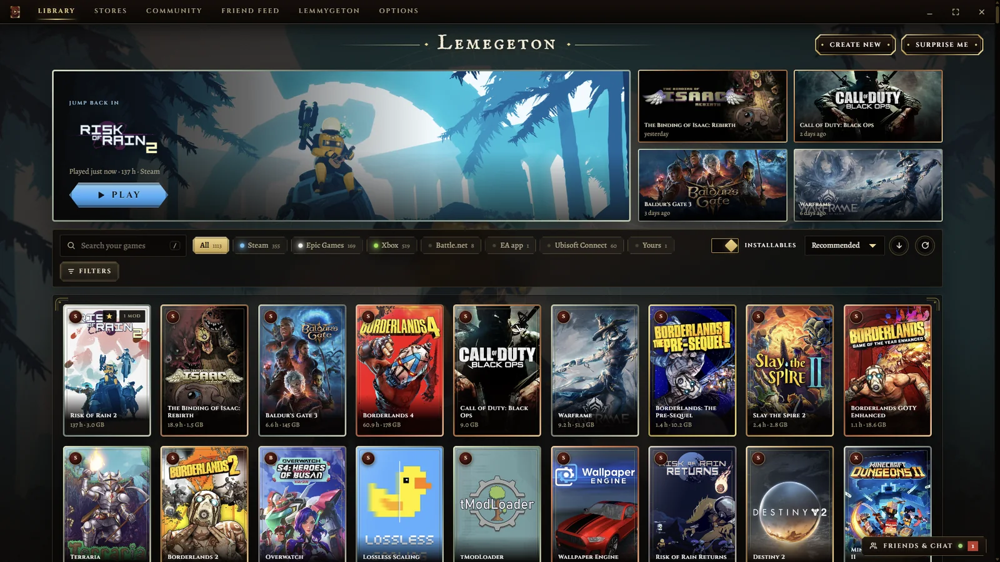
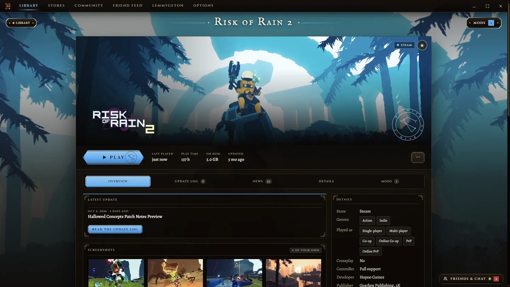
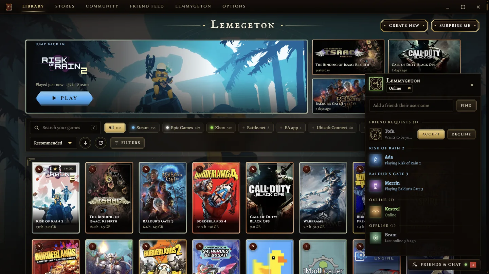
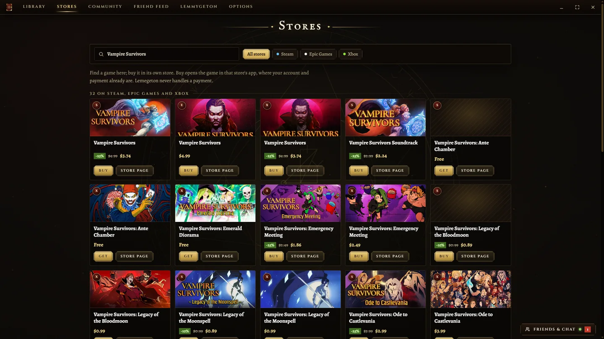
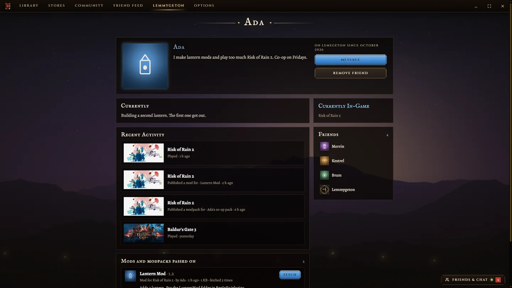
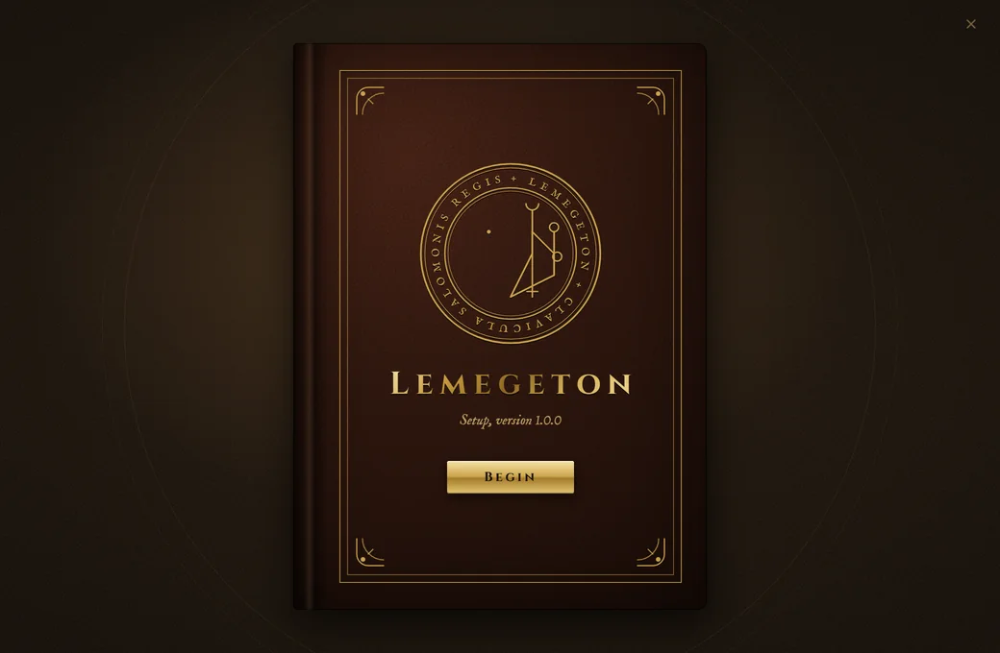
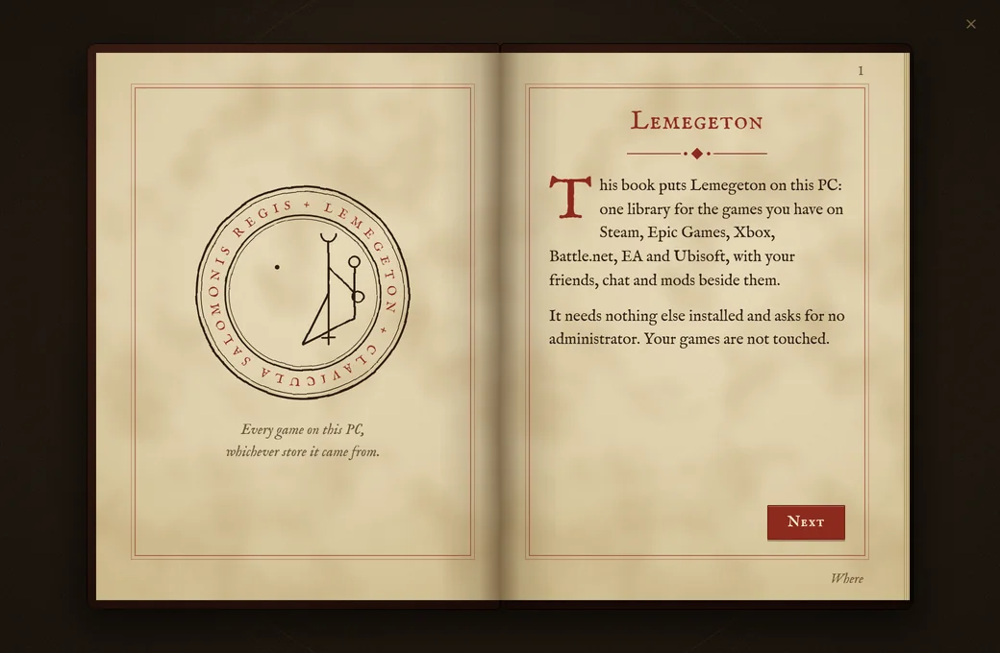
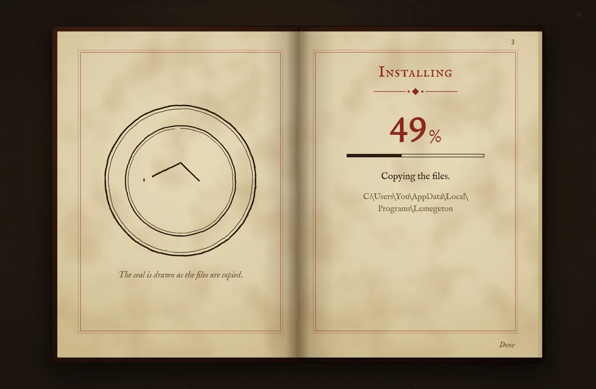

<h1 align="center">Lemegeton</h1>

Every game on this PC, whichever store it came from.

<a href="https://lemmygeton.github.io/Lemegeton/"><b>Download for Windows</b></a>

Lemegeton is one launcher for Steam, Epic Games, Xbox, Battle.net, EA and Ubisoft, with friends, chat and mods built in. It is for Windows 10 and 11.

## What is in it

- **One library.** It reads the games you own on all six stores and shows them together. Press Play and the game starts through its own store's app.
- **A page for every game.** What it is, its DLC, patch notes and news, and your mods for it. Each page takes its colours from the game's cover art.
- **The stores, in one place.** Pick a store and browse it: sales, top sellers and new releases on Steam, Epic Games and Xbox, or search all three together. Buying always happens in the store's own app; Lemegeton never sees a payment.
- **Friends and chat.** See who is online and what they are playing, and message them. It stays in the tray after you close the window, so messages still arrive.
- **Profiles.** A picture (animated if you like), a background, your own colour and a summary, with badges and your linked accounts (Steam, Discord and the rest). Open to everyone, or to friends only.
- **Mods.** Each game shows where its mods live. Search Nexus Mods, Thunderstore, Steam Workshop, GameBanana and Modrinth from inside it, and Get hands a mod to the tool that installs it. Build modpacks and pass them to your friends.
- **Updates.** It tells you when a new version is out and puts it in when you choose.

| | |
|---|---|
|  |  |
|  |  |

## The installer is a book

Each step is a page turning, and a seal draws itself while the files copy. It installs for your Windows account only and asks for no administrator.

| | | |
|---|---|---|
|  |  |  |

## Before you install

- **Windows will warn you.** The installer is not code-signed, so Windows SmartScreen says it does not know the publisher. Choose More info, then Run anyway.
- **What you need.** Windows 10 or 11, and the stores whose games you want to see. Lemegeton sits on top of them; it does not replace them.
- **Accounts are optional.** You can use it as a launcher without one. An account is only for friends, chat, profiles and sharing mods.
- **Where chat goes.** Accounts and chat run on a small hosted database looked after by the author. Chat is not end-to-end encrypted. What you are playing is shown to friends only if you switch that on.
- **Removing it.** Installed apps, in Windows Settings. You are asked whether to keep your settings.

The [download page](https://lemmygeton.github.io/Lemegeton/) always shows the newest version, what changed in it, and the installer's SHA-256 fingerprint.

## About this repository

This repository holds Lemegeton's download page. The program's source is not published here.

Lemegeton is not affiliated with Valve, Epic Games, Microsoft, Blizzard, Electronic Arts or Ubisoft. The game art in these pictures belongs to its owners.
